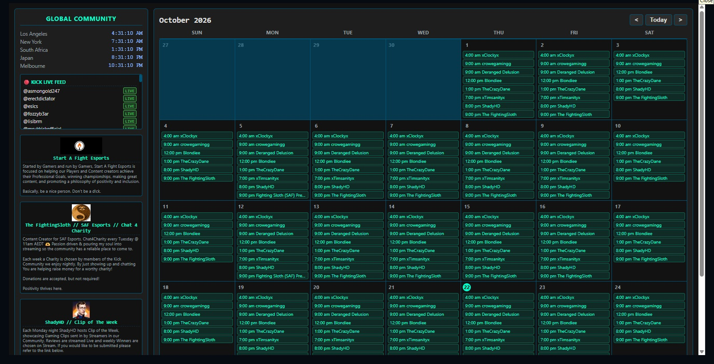
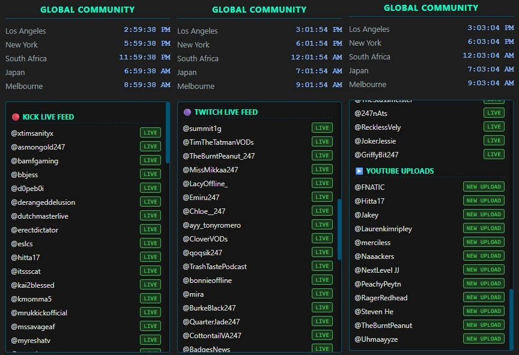
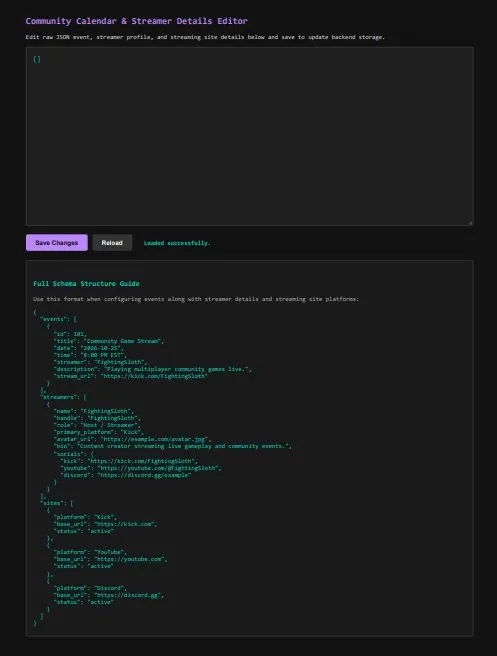

# Streaming Community Calendar Project

Streaming Community Calendar Project started as a way to help support streamers on Discord since Discord doesn't have a calendar of their own, just event posting. This project fuses together Kick live status, Twitch live listings, new YouTube upload postings, and a fully interactive calendar into a centralized, zero-cost cloud architecture.

---

## Interface Preview

| Full Dashboard & Calendar Matrix | Multi-Platform Feeds & Global Clocks |
| :---: | :---: |
|  |  |

| Community Calendar & Streamer Details Editor |
| :---: |
|  |

---

## Architecture & How It Works

To eliminate the need for always-on local hardware while maintaining fast, reliable data synchronization, this project utilizes a serverless, edge-native design:

* **Edge Execution (`server.js`)**: Built to run on serverless edge workers, handling incoming frontend requests and background routines without a traditional server runtime.
* **Automated Polling Triggers**: 
  * **YouTube Uploads**: Scanned on a regular 15-minute interval via data APIs.
  * **Kick & Twitch Live Status**: Polled on an hourly schedule to track active community creators across platforms.
* **Persistent Storage**: Utilizes key-value cloud storage bindings to maintain persistent records of scheduled calendar events and live status states.
* **Interactive Frontend (`calendar_index.html`)**: A responsive, clean dashboard hosted on edge pages that displays the community schedule, global community clocks, and live creator indicators in real time.
* **Discord Webhook Integration**: Automated notification pipelines designed to dispatch schedule drops and live status updates directly into community chat channels.

---

## Repository Structure

* `server.js` — Core backend worker script, API routing, and multi-platform polling logic.
* `calendar_index.html` — The main frontend dashboard and interactive calendar interface.
* `calendar.py` — Supporting utility script for local calendar management and data formatting.
* `0100100001001000.js` — Specialized module handler for routing and data formatting.
* `.env` — Local environment configuration template for API keys and endpoint secrets.

---

## Getting Started & Deployment

1. **Configure Environment Secrets**: Set up your required API keys (Twitch, YouTube) and notification webhooks securely within your deployment environment.
2. **Deploy Backend Worker**: Push the worker logic to your edge environment to activate automated cron schedules and API endpoints.
3. **Host Frontend Dashboard**: Deploy the static HTML interface to a global edge pages distribution for instant community access.
